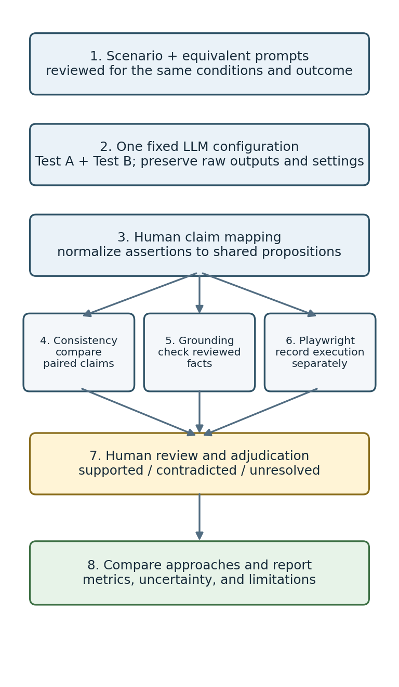
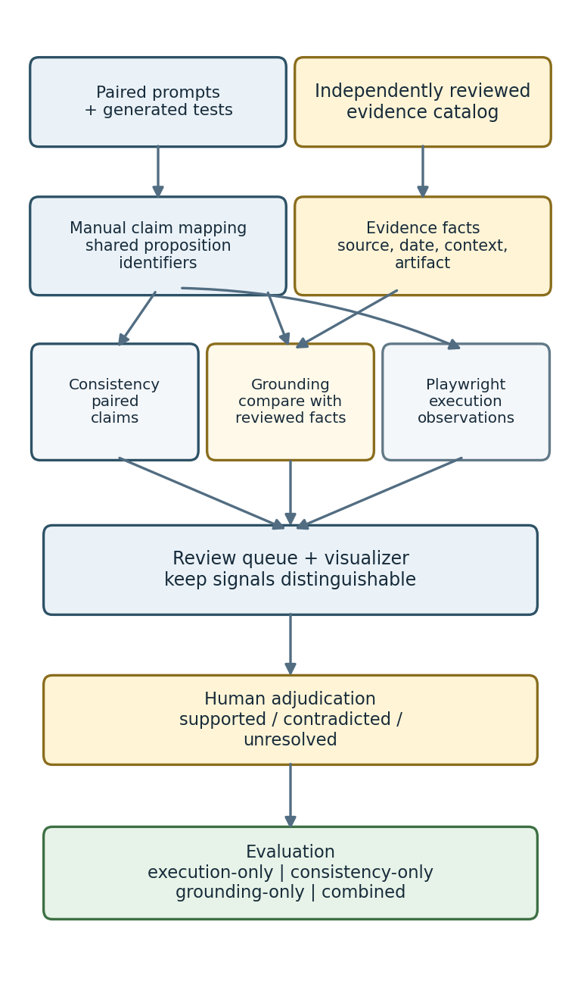

# Detecting Hallucinations in AI-Generated Playwright Tests: Prompt-Pair Consistency vs. Application Grounding

**Thesis progress:** I have implemented the research prototype; empirical evaluation remains in progress
**Status date:** October 22, 2026

## Abstract

Large language models (LLMs) can generate browser tests that appear plausible but assert application behavior that is unsupported or incorrect. In this thesis, I investigate a review workflow that combines meaning-preserving prompt mutations with independent application grounding to identify behavioral claims that need human review in LLM-generated Playwright UI tests. My workflow compares normalized claims from tests generated for two equivalent prompts, checks the claims against a separately reviewed evidence catalog, and records browser execution as a separate signal rather than as ground truth. So far, I have built a standalone SauceDemo prototype, a local visualizer, a deterministic claim analyzer, example scenarios that I authored, and Playwright TypeScript checks. On October 22, 2026, I ran the project checks: 13/13 analyzer tests passed, TypeScript type checking passed, and 9/9 Chromium browser and visualizer tests passed, including the visualizer checks with a nondefault port. These results verify the implementation only. My example pairs are not LLM outputs, the checkout fixture has no independently reviewed evidence facts, and I have not created a labeled dataset or measured detector accuracy. My next step is to collect genuine paired generations, document application evidence independently, adjudicate claim labels, and compare consistency-only, grounding-only, execution-only, and combined signals. I do not make an automatic hallucination verdict.

## Introduction

Automated user-interface (UI) tests express expectations about how an application responds to user actions. Large language models (LLMs) can draft these tests from natural-language instructions, but a syntactically valid test may still assert behavior that the application does not provide. Prior work on LLM-generated tests documents generation problems such as invalid or unreliable tests and explores repair and additional context as ways to improve them [1], [2]. For browser-based tests, a false behavioral expectation can be particularly difficult to identify because the test may execute without error or may fail for reasons unrelated to the expectation.

In my thesis, I focus on **behavioral claims**: normalized propositions about observable application behavior under stated conditions. For example, after a standard user adds a particular product, the cart contains that product with quantity one. Two generated scripts may use different locators and code structure while expressing the same claim. For that reason, I compare meaning rather than source-code identity.

I generate tests from a requirement and a meaning-preserving rewording, then examine whether their behavioral claims remain consistent. Metamorphic testing provides a basis for testing relations between outputs when a complete oracle is unavailable [3]. However, consistency is not correctness: two outputs can agree and still be wrong. I therefore add a separate grounding step that checks claims against application facts reviewed independently from the generated tests. I use Playwright execution to record what happened in a particular browser run, but I do not treat it alone as proof that a behavioral claim is true.

My research objective is to evaluate whether prompt-pair consistency, application grounding, and their combination help reviewers identify claims contradicted by reliable evidence. I evaluate a detection workflow using a pretrained LLM; I am not training a new model.

I address three research questions:

- **RQ1:** How frequently do generated Playwright tests from meaning-preserving prompt pairs disagree about user-visible behavior?
- **RQ2:** How accurately do consistency and evidence-grounding signals identify claims adjudicated as contradicted by human reviewers?
- **RQ3:** Does combining consistency and grounding improve detection compared with consistency-only, grounding-only, and execution-only approaches?

At this stage, I have produced a working software prototype and defined a research protocol. I cannot answer the empirical questions until I collect real LLM outputs and independently reviewed labels.

## Related work

Metamorphic testing was proposed for situations in which expected outputs are difficult to determine directly. It checks whether outputs satisfy relations expected to hold after a defined input transformation [3]. In my study, I use a rewording intended to preserve the meaning of a UI-test requirement. I will review prompt equivalence; if a transformation changes the user, precondition, action, or expected behavior, I will not treat the pair as meaning-preserving.

MetaQA applies metamorphic relations and prompt mutations to LLM hallucination detection [4]. SelfCheckGPT uses disagreement across sampled responses as a black-box factuality signal [5]. These works motivate me to use output inconsistency as a lead for investigation, but neither disagreement nor agreement establishes application-specific correctness. I add an independently reviewed application-evidence catalog and limit my conclusions to human-adjudicated behavioral claims.

LLM test-generation research has examined issues such as runtime failures, coverage, iterative repair, and repository context. TestART combines generation and repair feedback for unit tests [1], while RATester uses repository context to improve generated unit tests [2]. These studies are relevant to test reliability, but they differ from my main focus. I examine user-visible behavioral assertions in generated web UI tests, including claims that may be inconsistent across prompts or contradicted by application evidence.

Playwright Test is an end-to-end browser testing framework with TypeScript support, assertions, and reporting facilities [6]. I use it as my execution framework and as an aid for collecting evidence, not as an independent source of truth. My literature review is currently a focused starting point rather than a systematic review. I still need to search broader research databases and verify the sources.

## Methodology

### Study setting and scenario scope

I use SauceDemo, a public demo e-commerce application, as my initial target. I plan to cover successful and locked-out login; adding and removing an item from the cart; sorting products; checkout progression and confirmation; and logout. SauceDemo is suitable for a bounded pilot because browser automation can access its user-visible states. However, it is one public demo site that may change, so my results will not automatically generalize to production systems.

### Prompt-pair generation

For each scenario, I will prepare an original requirement and a reworded prompt. Before generation, I will check that both prompts preserve the same actor, preconditions, user actions, constraints, and expected observable outcomes. I will use the same selected LLM model/version and generation settings for both prompts. I will record the provider, model/version, instructions, sampling settings, date/time, exact prompts, unedited raw responses, and any generation failures. If I need to change a raw response to make it run, I will keep the original unchanged and document the runnable copy separately.

My current planning target is five scenario families with eight paired repetitions per family (up to 40 pairs and 80 generated tests). This is a feasibility target, not a statistical power calculation. I will review it after completing a pilot.

### Claim mapping and evidence

I will manually review each generated test and map its assertions to behavioral propositions with stable identifiers. I will pair claims only when they have the same meaning and conditions; I will not treat an assertion omitted from one test as a contradictory assertion. My current analyzer expects me to provide this structured mapping; it does not automatically extract claims from TypeScript or natural-language prompts.

I will collect evidence independently from the generated tests. For each evidence record, I will identify the proposition, source, observation date, application context, preconditions, method, observed outcome, and supporting artifact where practical. I will assign each claim one of three human-reviewed labels: **supported**, **contradicted**, or **unresolved**. I will mark missing or ambiguous evidence as unresolved, not false. If a second reviewer is available, I will ask them to label a subset and record disagreements and adjudication.

### Workflow

Figure 1 summarizes the workflow I will follow. I keep model generation, evidence collection, and browser execution distinct so that execution outcomes do not become ground truth.

I will follow this workflow:

1. Define a test scenario and create two prompts with the same behavior requirements.
2. Review the prompts for semantic equivalence before sending them to the model.
3. Generate both tests with the same recorded model and configuration; archive raw outputs and metadata.
4. Manually map each test's behavioral assertions to shared proposition identifiers.
5. Independently observe SauceDemo, date the observations, and record supporting artifacts and reviewed facts.
6. Analyze pair consistency and evidence conflicts separately; run the tests and preserve execution output as a separate signal.
7. Human-review candidate findings, assign supported/contradicted/unresolved labels, and evaluate the approaches against the adjudicated labels.

### Detection and evaluation design

I plan to compare four approaches: (1) execution-only, based on browser-test outcomes; (2) consistency-only, based on paired claim disagreements; (3) grounding-only, based on conflicts with reviewed evidence; and (4) a combined approach using rules that I will define in advance. I will compare the results with human-adjudicated claim labels. My primary positive class will be a contradicted behavioral claim. I will report unresolved cases separately and exclude them from binary primary metrics; if the sample allows, I will also conduct a sensitivity analysis. I will specify the combined decision rule before examining the final labels.

I plan to report claim-level confusion matrices, precision, recall, F1, and false-positive rate, as well as pair-level disagreement and detection counts. Where feasible, I will report counts and uncertainty intervals with the estimates. I will examine scenario families and common errors, including valid code differences, unequal claim coverage, incorrect prompt equivalence, shared wrong expectations, and infrastructure-related execution failures.

## Experiment/evaluation

### Work completed to date

So far, I have built a standalone project in `saucedemo-research/`. My prototype contains:

- a deterministic analyzer that validates paired scenario JSON, groups claims by proposition, flags opposite expectations, and checks claims against supplied facts;
- a local visualizer for loading and editing scenarios and reviewing comparison results;
- Playwright TypeScript browser checks for standard and locked-out login, cart operations, backpack add-to-cart, product sorting, a complete backpack checkout, and the visualizer;
- a checkout scenario fixture with example claims that I authored; its evidence facts remain empty pending independent review.

I designed the analyzer to distinguish pair disagreement, one-sided claim coverage, evidence conflict, and missing evidence. It rejects malformed proposition keys and duplicate propositions within a run, and warns about identical prompts or runs with no claims. It does not use browser pass/fail as ground truth or make an automatic hallucination classification.

Figure 2 shows how I separate the prototype's structured claim analysis from Playwright execution and connect both only at the human-review stage.

### Implementation verification

On October 22, 2026, I ran the targeted project checks: **13/13 analyzer unit tests passed**, **TypeScript type checking passed**, and **9/9 Chromium Playwright browser and visualizer tests passed**. The visualizer checks also passed with a nondefault port. The checkout test reached the confirmation state on the public demo site in that run. These checks show that selected software components work together; they do not measure the accuracy or effectiveness of my research method.

### Empirical-study status

I have not completed the empirical study yet. I have not collected paired tests generated by an LLM in the current fixture or entered independently reviewed facts for the checkout claims, and I have not created an evaluation dataset with human-provided labels. My current schema also does not enforce per-fact observation metadata, capture human adjudication labels or reviewer identity, or preserve LLM generation provenance. I have not implemented batch evaluation or metric calculations. Therefore, I have **no empirical detection results** to report: I have not measured precision, recall, F1, false-positive rate, or reviewer agreement. The browser checks document implementation and execution only; agreement in my example fixture does not establish that its claims are correct.

My next experiment is a pilot using a fixed, documented model configuration. I will use it to assess whether I can review prompt pairs consistently, map claims reliably, find independent evidence for each proposition, and manage the generation and review effort. After I refine the protocol, I plan to work toward my provisional 40-pair collection target.

## Discussion and future work

My work so far demonstrates that the prototype workflow is feasible: I can compare structured claims deterministically, keep supplied evidence separate from execution results, and present the signals in a visualizer for review. My most important outcome so far is methodological rather than empirical. I have kept the prototype from treating agreement between model outputs as truth, disagreement as proof of hallucination, or a passing browser test as an independent oracle.

I recognize several limitations. First, I authored the current claim mappings and paired prompts as examples; they are not model-generated data. Second, SauceDemo is a single public application whose behavior may change, so I must date evidence and tie it to observed conditions. Third, my manual claim mapping and prompt-equivalence review may introduce subjectivity. Fourth, I have tested too few scenarios to make claims about generalization. Finally, my operational definition focuses narrowly on claims contradicted by evidence; I will need to analyze unresolved statements and other test-quality problems separately.

Next, I will select a model with documented version and settings, prepare and review equivalent prompt pairs, collect the raw generations, map claims using a written annotation guide, and inspect the target application independently. If I can involve a second reviewer, I will ask them to label a subset and help adjudicate disagreements. I will then predeclare the detection rules, run the four comparison approaches, calculate metrics against the reviewed labels, and report uncertainty, false positives, false negatives, unresolved cases, and deviations from my protocol. I will consider additional applications or automatic claim extraction only after a successful pilot because either change introduces more validity threats.

In summary, I have moved from a research proposal to a runnable prototype and a testable study protocol. I have not yet validated hallucination detection empirically. My next milestone is to build a small, auditable pilot dataset containing genuine paired LLM outputs and independently reviewed application evidence.

## References

[1] S. Gu et al., “TestART: Improving LLM-based unit testing via co-evolution of automated generation and repair iteration,” arXiv:2408.03095, 2024. [Online]. Available: https://arxiv.org/abs/2408.03095.

[2] X. Yin et al., “Enhancing LLM’s ability to generate more repository-aware unit tests through precise contextual information injection,” arXiv:2501.07425, 2025. [Online]. Available: https://arxiv.org/abs/2501.07425.

[3] T. Y. Chen, S. C. Cheung, and S. M. Yiu, “Metamorphic testing: a new approach for generating next test cases,” Hong Kong University of Science and Technology, Department of Computer Science, Technical Report HKUST-CS98-01, 1998.

[4] B. Yang, M. A. Al Mamun, J. M. Zhang, and G. Uddin, “Hallucination detection in large language models with metamorphic relations,” *Proceedings of the ACM on Software Engineering*, vol. 2, no. FSE, pp. 425–445, 2025, doi: 10.1145/3715735.

[5] P. Manakul, A. Liusie, and M. J. F. Gales, “SelfCheckGPT: zero-resource black-box hallucination detection for generative large language models,” in *Proceedings of the 2023 Conference on Empirical Methods in Natural Language Processing*, pp. 9004–9017, 2023, doi: 10.18653/v1/2023.emnlp-main.557.

[6] Microsoft, “Playwright Test: Introduction,” Playwright documentation. [Online]. Available: https://playwright.dev/docs/intro. Accessed: Oct. 22, 2026.
