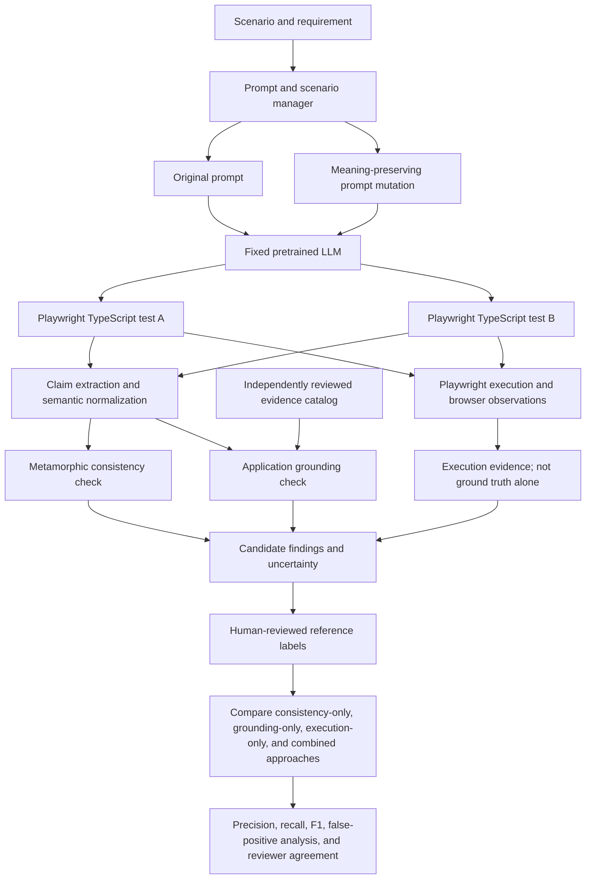

# Detecting Hallucinations in AI-Generated Software Test Cases: An Evaluation of Metamorphic Testing for Playwright UI Tests

**Paper type:** Research proposal
**Status:** Proposed study; experiments and results have not yet been completed.

## Abstract

Large language models (LLMs) can generate browser-based software tests quickly, but a plausible-looking test may assert behavior that the application does not provide. Such unsupported expectations can create false confidence, waste debugging effort, or encode incorrect requirements. This proposal investigates whether metamorphic testing can help identify these problems in LLM-generated Playwright UI tests. A fixed, pretrained LLM will generate tests from an original requirement and a meaning-preserving rephrasing. The generated code will be represented as behavioral claims and compared for semantic consistency, rather than for literal code or locator equality. Claims will also be checked against an independently reviewed evidence catalog describing the target application’s requirements and observed behavior. Playwright execution and browser evidence will be recorded as additional signals, not treated as ground truth by themselves. A human-reviewed dataset will be used to compare consistency-only, grounding-only, execution-only, and combined detection approaches. The initial study is scoped to a controlled demo application, with SauceDemo proposed as the target, and a small set of login, cart, sorting, checkout, and logout scenarios. The study will report claim- and pair-level precision, recall, F1, false-positive rates, and reviewer agreement where a second reviewer is available. The objective is to measure when metamorphic checks add value, where they produce false alarms, and how application grounding changes their reliability.

**Keywords:** large language models, software testing, UI test generation, hallucination detection, metamorphic testing, Playwright, test oracle

## 1. Introduction

Large language models are increasingly used to draft automated tests from natural-language requirements. For web applications, generated browser tests may include navigation steps, locators, assertions, and test data. These scripts can reduce the effort required to create an initial test suite, but their syntactic plausibility does not guarantee that their assertions describe the real application.

An AI-generated UI test can, for example, assert that a locked account reaches an inventory page, that a cart count changes before an item is added, or that a control exists when the application offers no such behavior. These are not merely code-generation defects: the test may encode a false behavioral claim. A passing test does not prove that its claim is correct, and a failing test may reflect timing, environment, or locator problems rather than a hallucinated expectation.

This study proposes adapting metamorphic testing for LLM hallucination detection to generated Playwright TypeScript tests. In the original setting, a model’s response to a prompt is compared with its response to a related, transformed prompt under a predefined metamorphic relation. Here, the transformation is a meaning-preserving rephrasing of a UI requirement. The central expectation is that equivalent requirements should yield equivalent user-visible behavioral claims, even when the generated scripts use different code or locators.

Consistency alone is insufficient to establish correctness. Two generated tests may agree and both be wrong; alternatively, they may use different valid implementations while asserting the same behavior. The proposed system therefore combines a metamorphic comparison with a separate application-grounding check against independently collected evidence. Human-reviewed labels provide the evaluation reference. Playwright execution and MCP-assisted browser inspection support evidence collection and execution analysis but do not act as an automatic oracle.

The study asks whether this combination can identify unsupported claims more reliably than simpler approaches. It is an evaluation of a pretrained LLM and a detection workflow, not the design or training of a new model.

### 1.1 Problem statement

There is a need to evaluate whether metamorphic consistency checks can help detect unsupported behavioral claims in AI-generated web UI tests, and whether independently verified application evidence reduces the false alarms and missed cases that consistency checks alone may produce.

### 1.2 Research questions

- **RQ1:** How often do generated Playwright tests from meaning-preserving prompt pairs disagree about user-visible behavior?
- **RQ2:** How accurately do metamorphic consistency checks identify human-reviewed unsupported or contradicted behavioral claims?
- **RQ3:** Does application grounding improve detection performance compared with consistency-only and execution-only approaches?
- **RQ4:** What types of false positives and unresolved cases arise, including valid differences in test code that preserve the same behavior?

## 2. Background

### 2.1 LLM-generated UI tests and test oracles

A UI test typically combines an action sequence with assertions about the resulting interface or application state. The assertion is an oracle: it decides whether the observed behavior matches an expected outcome. If an LLM invents or misstates that outcome, the test can be wrong even when it compiles, locates elements, and passes consistently.

This proposal focuses on **behavioral claims** made by a test. A claim is a normalized proposition about observable application behavior under a specified scenario, such as:

> Given a locked-out account submits valid-looking login credentials, the user does not reach the inventory page.

The study does not require generated scripts to have identical syntax, page-object structure, or selectors. Two tests may use different implementations and still make the same behavioral claim.

### 2.2 Hallucination and evidence

For this study, an **unsupported claim** is a generated behavioral expectation that lacks support in the independently reviewed requirements and application evidence. A claim that directly contradicts such evidence is a stronger candidate for a hallucination label. A claim for which evidence is missing or ambiguous is marked **unresolved**, not automatically false.

The term “hallucination” is used as a research label for a generated claim that is demonstrably unsupported or contradicted by the reference evidence. It is not inferred solely from a test failure, a locator timeout, or disagreement between two generated scripts.

### 2.3 Metamorphic testing

Metamorphic testing is useful when a direct oracle is unavailable or incomplete. Instead of checking one output against a known answer, it checks whether outputs satisfy a relation expected to hold across related inputs. For this study, the primary relation is **meaning-preserving prompt invariance**:

> Rephrasing a requirement without changing its scenario or expected behavior should preserve the test’s user-visible behavioral claims.

This relation applies to semantic claims, not literal code. It is valid only after the prompt pair has been reviewed as equivalent. Prompts that intentionally change a requirement—such as changing a valid account to a locked account—are not equivalent-prompt mutations and require a different, explicitly specified relation. Such mutations are outside the primary experiment.

## 3. State of the Art and Research Gap

Existing work provides foundations in three adjacent areas: metamorphic hallucination detection, LLM-based web-test generation, and reliability problems in generated software tests.

| Area | Representative work | Relevance to this proposal |
|---|---|---|
| Metamorphic hallucination detection | MetaQA uses prompt mutations and metamorphic relations to identify inconsistencies in LLM responses (Yang et al., 2025). | Provides the conceptual basis for comparing outputs from related prompts. This study adapts the idea to behavioral claims in generated UI tests and adds application evidence. |
| Web UI test generation | Le et al. (2025) study LLM-based end-to-end web test generation using screen-transition and state representations. | Establishes that LLM-generated web tests are an active area. The proposed study focuses on evaluating unsupported claims, not primarily on increasing test-generation coverage. |
| Reliability of generated software tests | TestART studies unit-test generation and repair, including compilation and runtime problems (Gu et al., 2024). RATester studies repository context for reducing errors in generated unit tests (Yin et al., 2025). | Shows that generated tests can contain reliability problems and that context can help. These studies concern unit-test generation and code context rather than metamorphic evaluation of UI behavior claims. |

The proposed contribution is the **empirical evaluation** of whether meaning-preserving prompt mutations, combined with application grounding, can detect unsupported behavioral claims in generated Playwright UI tests. The study does not claim that this exact combination is novel. A systematic literature review is required before making a priority or novelty claim, especially because research on LLM-based end-to-end testing and generated-test correctness is evolving.

## 4. Proposed Architecture

The architecture is an evaluation pipeline around a fixed, pretrained LLM. It does not train or fine-tune a model. A prompt/scenario manager creates a baseline requirement and a meaning-preserving variation. Both are sent to the same recorded model and generation configuration. The outputs are normalized into behavioral claims, checked through separate consistency and grounding paths, and compared with reviewed labels.

### 4.1 Components

1. **Scenario and requirement manager.** Stores each scenario, its expected user-visible behavior, the original prompt, the transformed prompt, and the reviewed judgment that the pair preserves meaning.
2. **Prompt mutator.** Produces a paraphrase that preserves the actors, preconditions, actions, and expected outcomes. Mutations are reviewed before generation; semantic equivalence is not assumed simply because a paraphrase tool produced them.
3. **LLM test generator.** Generates Playwright TypeScript tests for both prompts. The exact model/provider/version, system instructions, sampling parameters, timestamp, and prompt text are recorded for reproducibility. A single fixed model configuration is used within each comparison.
4. **Claim extraction and normalization.** Converts each generated test into structured behavioral claims associated with the scenario. The original script is retained. Human review resolves ambiguous claim mappings; exact code or selector equality is not required.
5. **Metamorphic consistency detector.** Flags pairs whose normalized claims conflict under the predefined meaning-preserving relation. It reports the conflicting claims and does not automatically label the pair hallucinated.
6. **Evidence catalog and grounding detector.** Stores the requirement, independently checked expected outcome, application version or access date, observation method, and evidence artifact where feasible. Generated tests do not create their own ground truth. The grounding check labels claims as supported, contradicted, or unresolved against this catalog.
7. **Execution and browser evidence.** Playwright runs the generated tests and records outcomes, traces, screenshots, and observed state where feasible. MCP may be used as a browser-tool interface for inspection or interaction. MCP is not the detector, and execution pass/fail remains a separate signal.
8. **Human review and evaluation.** Reviewers adjudicate claim labels using the saved evidence and compare detector outputs to these reference labels. Candidate flags remain reviewable findings rather than automatic declarations of hallucination.

### 4.2 Detection outputs

The system keeps different failure modes separate:

- **Metamorphic contradiction:** equivalent prompts led to conflicting behavioral claims.
- **Evidence contradiction:** a generated claim directly conflicts with reviewed application evidence.
- **Evidence supported:** the claim matches available reviewed evidence.
- **Unresolved:** evidence is absent, ambiguous, or insufficient for a reliable judgment.
- **Execution or infrastructure issue:** compilation, locator, timing, navigation, or environment failure that does not by itself establish a false behavioral claim.

The combined detector is evaluated as a candidate-flagging strategy. Whether it should flag on either a metamorphic violation or an evidence contradiction, and how unresolved cases are handled, will be specified before the final evaluation to avoid tuning on the test labels.

## 5. Research Methodology

### 5.1 Study design and target application

The initial study will use **SauceDemo** (`https://www.saucedemo.com/`), a publicly accessible interactive demo web application, rather than a Salesforce instance requiring private access. Its UI supports visible state changes suitable for controlled scenarios: successful or blocked login, adding and removing cart items, sorting inventory, checkout progression, and logout. The Playwright smoke suite exercises login, cart, and sorting changes. Before using any behavior as research evidence, the study will independently verify it against the live demo, record the observation date and artifacts, and account for changes in the site. The example fixture bundled with the prototype remains illustrative until this verification is done.

The initial scenario families are:

1. Login outcomes for standard and locked-out accounts.
2. Adding and removing a product in the cart.
3. Sorting products and checking the visible order.
4. Checkout form validation and progression.
5. Logging out and verifying the resulting state.

For each scenario, a requirement and a paraphrase will be prepared. Each pair will be reviewed to verify that the transformation preserves preconditions and expected behavior. A pilot will be used to refine the scenario format, claim taxonomy, evidence capture procedure, and sample target before the main collection begins.

### 5.2 Generation and data collection

The planned initial target is **five scenario families with eight generation repetitions each**, yielding up to 40 prompt pairs (80 generated tests). This is a feasibility target, not a statistical power claim; it may be revised after the pilot and must be reported transparently. For each output, the study will retain:

- scenario identifier, requirement, original prompt, and mutated prompt;
- reviewer decision and rationale for prompt-pair equivalence;
- model/provider/version and generation settings;
- raw generated TypeScript and normalized behavioral claims;
- evidence-catalog version and supporting observations;
- Playwright version, browser, execution result, trace or other relevant artifacts;
- human label, reviewer identity coded for analysis, and rationale.

Generation order should be randomized or counterbalanced where feasible. Settings and prompt templates will be held constant within a comparison. Failed or incomplete generations will be retained and categorized rather than silently discarded.

### 5.3 Evidence collection and labeling

The evidence catalog will be prepared independently from the generated tests. It will combine the scenario requirement with direct observations of the target application under the stated preconditions. A Playwright/MCP session may help collect screenshots, visible text, routes, and state transitions, but evidence used as a reference must be reviewed and saved independently of the generated assertions.

Each claim will be assigned one of three principal labels:

- **Supported:** the claim matches the requirement and the observed application behavior.
- **Contradicted:** reliable evidence directly shows that the claim is false under the specified scenario.
- **Unresolved:** the evidence does not support a confident judgment, or the claim is ambiguous.

Only contradicted claims will be treated as clear hallucination candidates for primary detection metrics. Unsupported but unresolved claims will be reported separately, not counted as false by default. A second reviewer should independently label a subset when feasible. Disagreements will be adjudicated and inter-rater agreement reported, with the labeling guide and disagreement categories preserved.

### 5.4 Comparisons and analysis

The study will compare at least these approaches:

1. **Execution-only baseline:** uses Playwright outcomes and recorded execution observations.
2. **Consistency-only:** uses metamorphic disagreements between paired behavioral claims.
3. **Grounding-only:** compares claims to the evidence catalog without using pair consistency.
4. **Combined approach:** uses both metamorphic and grounding signals under a predeclared decision rule.

For each approach, results will be compared against human-reviewed claim labels. The study will report confusion matrices, precision, recall, F1, and false-positive rates at claim level; pair-level results will also be reported where applicable. Unresolved labels will be excluded from binary primary metrics and reported separately, with a sensitivity analysis if sample size permits. Counts and confidence intervals will be included where appropriate. The study will analyze false positives, especially cases where two scripts differ structurally but make equivalent behavioral assertions, and false negatives, especially cases where both prompts produce the same incorrect expectation.

### 5.5 Threats to validity

- **Construct validity:** “Hallucination” can be broader than a false assertion. The operational definition is restricted to generated behavioral claims contradicted by reviewed evidence; unresolved claims are distinguished.
- **Prompt validity:** a paraphrase may unintentionally change the requirement. Equivalence review and preservation of preconditions mitigate this risk.
- **Oracle validity:** the evidence catalog may be incomplete or incorrect. Independent collection, artifact retention, reviewer adjudication, and version tracking reduce but do not eliminate this risk.
- **Model variability:** outputs can vary across runs and model versions. Repeated generations and complete model/configuration records make this variability observable.
- **Execution validity:** UI tests can fail because of timing, infrastructure, selectors, or environment. Execution is a separate signal and failures are categorized rather than equated with hallucinations.
- **External validity:** a single demo application and limited scenarios cannot establish performance across production applications, devices, or frameworks.
- **Reviewer bias:** reviewers may know which approach produced a flag. Blinded review of generated outputs and a second reviewer on a subset should be used where feasible.

## 6. Expected Contributions

Because this is a proposal, the following are intended contributions rather than completed findings:

1. A reproducible protocol for creating and reviewing meaning-preserving prompt pairs for UI test generation.
2. A behavioral-claim representation that supports comparing generated tests without requiring code identity.
3. An evaluation that separates metamorphic inconsistency, evidence conflict, and execution failure.
4. A comparison of consistency-only, grounding-only, execution-only, and combined signals against human-reviewed labels.
5. A documented, auditable pilot dataset for a bounded set of demo-application scenarios, subject to application terms and evidence-handling constraints.

The study does not assume that metamorphic checks will be effective. It is designed to measure their contribution and characterize their limitations.

## 7. Proposed Work Plan

| Weeks | Planned activity |
|---|---|
| 1–2 | Confirm target application and scope; review the closest literature; define operational labels, scenarios, and evidence-capture protocol. |
| 3 | Pilot prompt pairs and evidence collection; revise the labeling guide and analysis plan before the main run. |
| 4–5 | Collect paired generations across the selected scenarios; retain raw prompts, scripts, model settings, and execution artifacts. |
| 6 | Complete claim normalization, independent labeling, and adjudication; compute reviewer agreement where applicable. |
| 7 | Compare baselines, calculate metrics, and analyze false positives, false negatives, and unresolved cases. |
| 8 | Write the results, limitations, reproducibility materials, and final thesis or course-paper revision. |

## 8. Conclusion

This proposal studies whether metamorphic relations can help detect unsupported behavioral claims in AI-generated Playwright UI tests. It extends prompt-mutation reasoning to a software-testing context while addressing a key limitation of consistency-only detection: generated tests may agree and still be wrong. The architecture therefore separates claim consistency, application grounding, browser execution, and human-reviewed evaluation. Its central outcome is empirical evidence about when these signals help, when they fail, and what additional validation is required before a candidate finding can reasonably be called a hallucination.

## References

1. Yang, B., Al Mamun, M. A., Zhang, J. M., & Uddin, G. (2025). Hallucination detection in large language models with metamorphic relations. *Proceedings of the ACM on Software Engineering, 2*(FSE), 425–445. https://doi.org/10.1145/3715735
2. Le, N.-K., Bui, Q. M., Nguyen, M. N., Nguyen, H., Vo, T., Luu, S. T., Nomura, S., & Nguyen, M. L. (2025). Automated web application testing: End-to-end test case generation with large language models and screen transition graphs. *Proceedings of JSAI 2025*. https://doi.org/10.11517/pjsai.JSAI2025.0_3K4IS2a03
3. Gu, S., Zhang, Q., Li, K., Fang, C., Tian, F., Zhu, L., Zhou, J., & Chen, Z. (2024). TestART: Improving LLM-based unit testing via co-evolution of automated generation and repair iteration. *arXiv preprint arXiv:2408.03095*. https://arxiv.org/abs/2408.03095
4. Yin, X., Ni, C., Li, X., Chen, L., Ma, G., & Yang, X. (2025). Enhancing LLM's ability to generate more repository-aware unit tests through precise contextual information injection. *arXiv preprint arXiv:2501.07425*. https://arxiv.org/abs/2501.07425

*The references above are representative starting points from an initial literature scan, not a completed systematic review. The final manuscript should verify each source against its publisher record and expand the search before making a novelty claim.*
